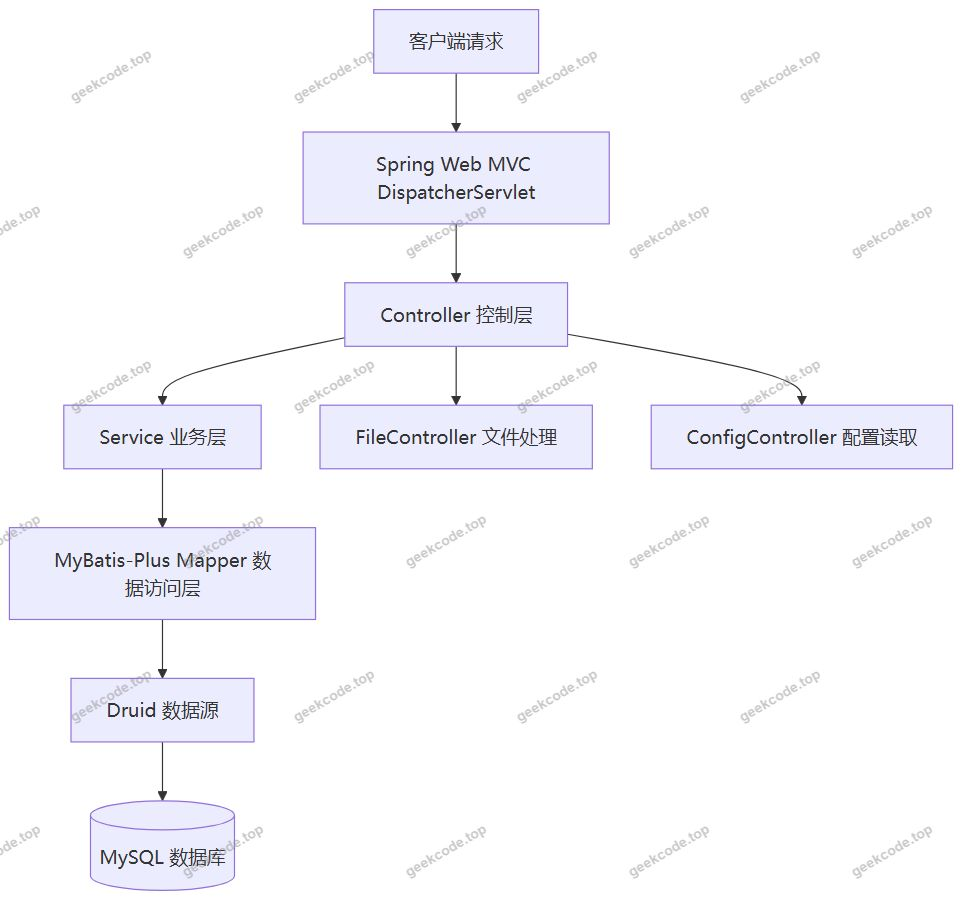
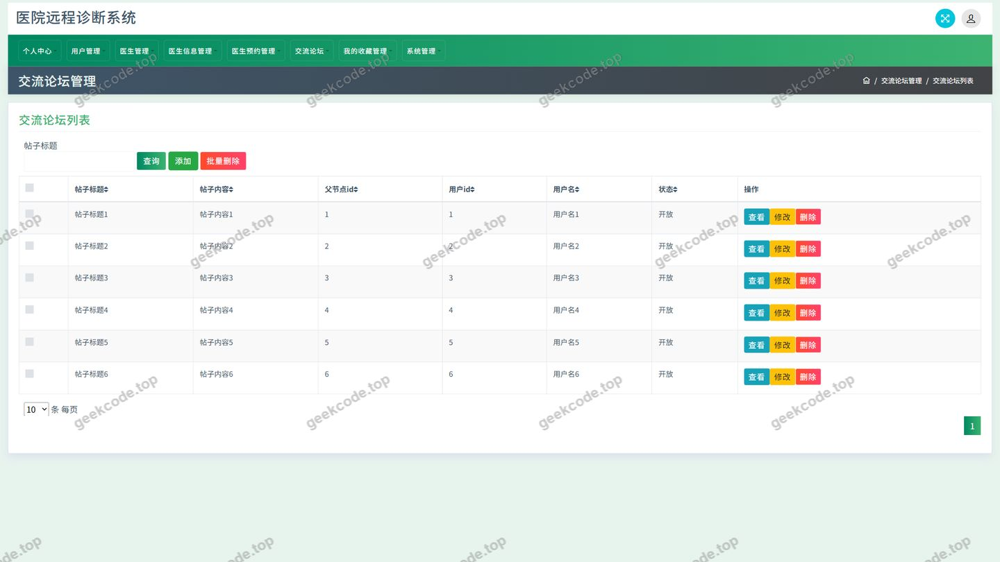
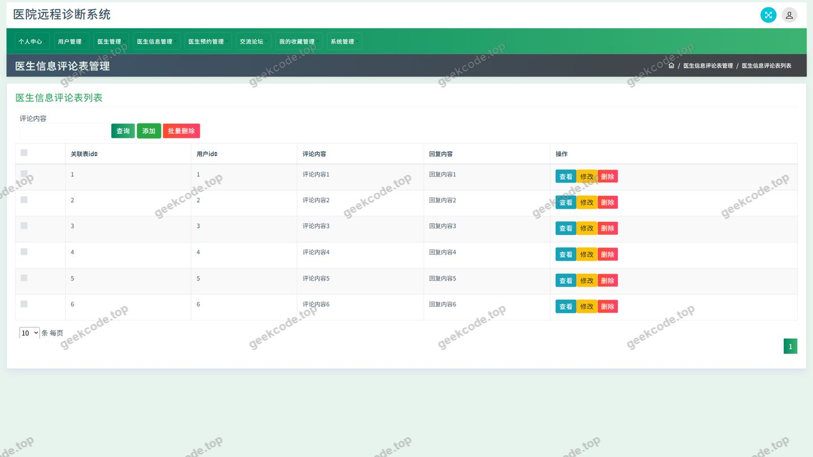
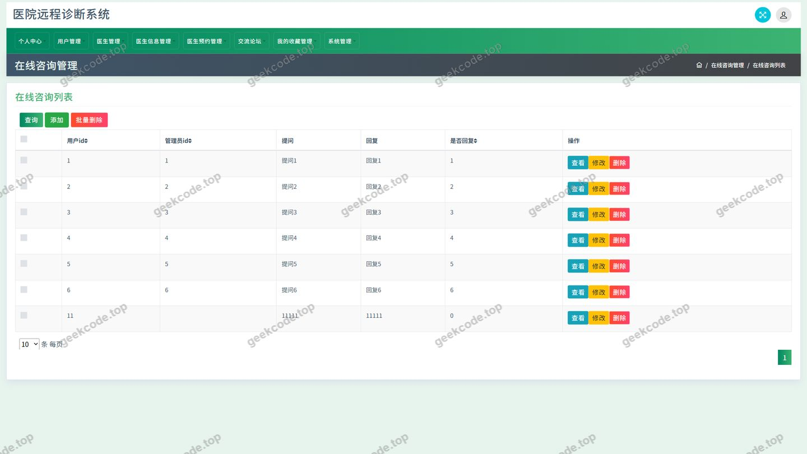
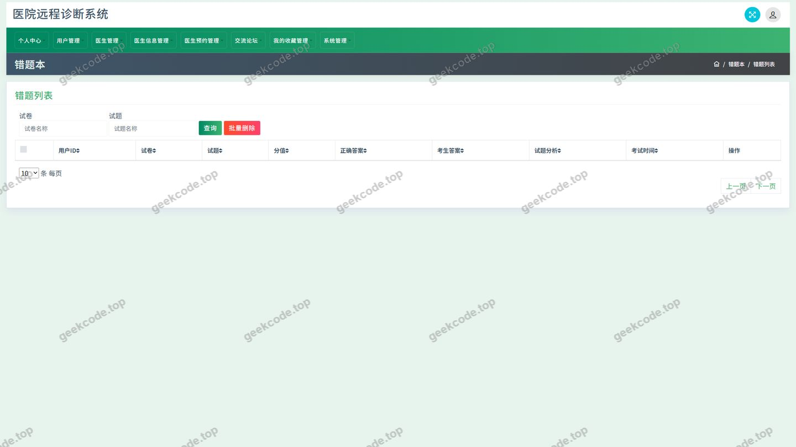
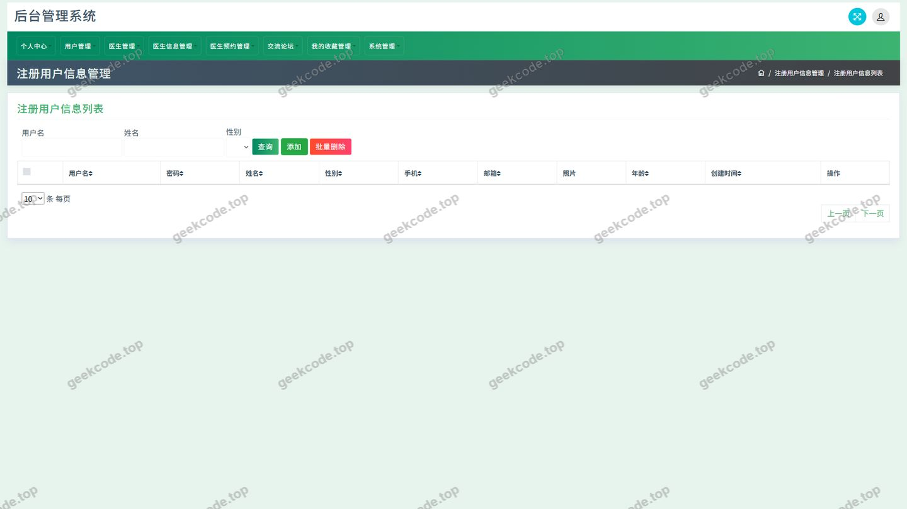
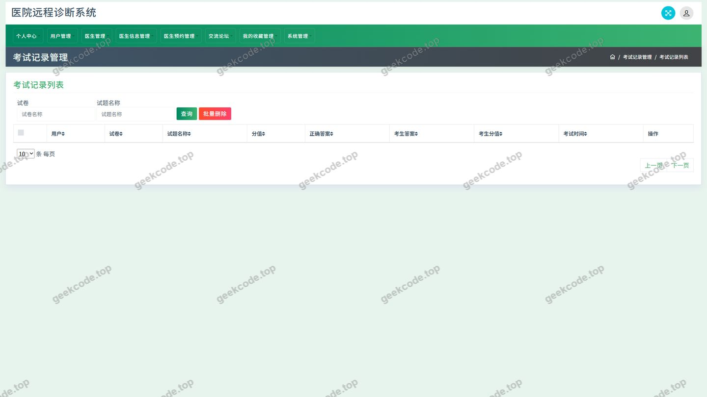
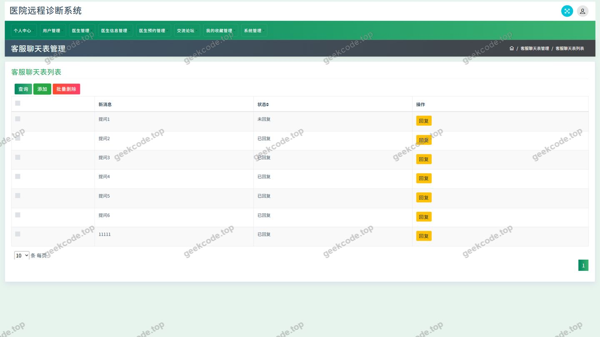
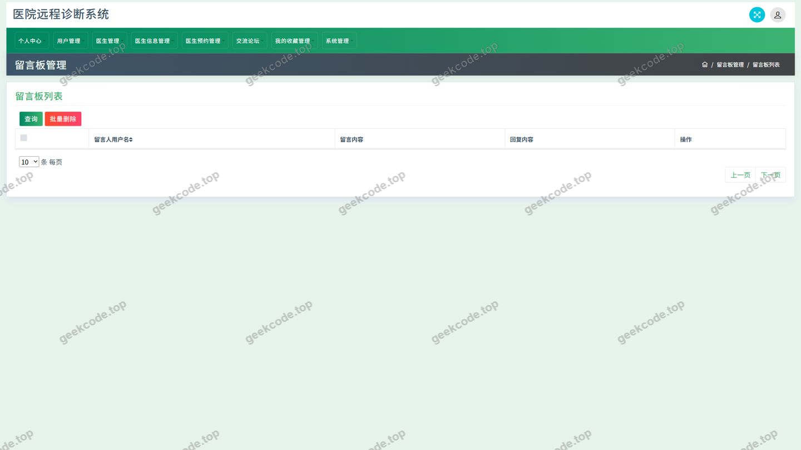

# ssm医院远程诊断系统-java毕业设计-带论文

> 🎓 **计算机毕业设计 · ssm医院远程诊断系统-java毕业设计-带论文**
>
> 本仓库只放**项目介绍 + 运行截图**（截图是站点带水印的原图，存在仓库 `images/` 里）。
>
> 👉 **完整可运行源码 / 数据库脚本 / 部署文档：[点我获取](https://geekcode.top/archives/ssm%E5%8C%BB%E9%99%A2%E8%BF%9C%E7%A8%8B%E8%AF%8A%E6%96%AD%E7%B3%BB%E7%BB%9F-java%E6%AF%95%E4%B8%9A%E8%AE%BE%E8%AE%A1-%E5%B8%A6%E8%AE%BA%E6%96%87?utm_source=github)**
>
> 💬 咨询微信：**ir9372**　|　🌐 更多项目：[极客代码 geekcode.top](https://geekcode.top/?utm_source=github)
>
> 📌 项目详情页：<https://geekcode.top/archives/ssm%E5%8C%BB%E9%99%A2%E8%BF%9C%E7%A8%8B%E8%AF%8A%E6%96%AD%E7%B3%BB%E7%BB%9F-java%E6%AF%95%E4%B8%9A%E8%AE%BE%E8%AE%A1-%E5%B8%A6%E8%AE%BA%E6%96%87?utm_source=github>

<table><td width="230" align="center"> <b>扫码加微信 ir9372</b></td><td valign="middle">📦 源码 = 项目介绍 + 全部运行截图 + 数据库 + 部署文档 👉 点上方任意截图，直接跳到 <b>极客代码 geekcode.top</b> 详情页</td></table>

---

<h1>ssm医院远程诊断系统-java毕业设计-带论文</h1>
<h2>项目概述</h2>

本项目为医院远程诊断系统，属于面向网络医疗场景的信息管理类毕业设计项目，工程类型为纯接口服务（pure-api），后端仅对外提供数据接口，不包含服务端渲染页面。系统围绕&quot;医生资源&quot;这一核心对象展开，向普通用户提供医生信息浏览、医生预约、医生信息评论、交流论坛、收藏、在线交流等能力，同时提供用户管理、医生管理、系统配置、文件管理等管理侧接口。前端导航划分为&quot;医生信息&quot;&quot;论坛信息&quot;两大主入口，个人中心下设&quot;个人中心&quot;&quot;我的发布&quot;&quot;我的收藏&quot;三个子入口，构成用户侧的完整操作闭环。系统采用传统 Spring Web MVC 分层架构，持久层使用 MyBatis-Plus 简化单表与条件查询，数据源使用 Druid 连接池进行管理与监控，事务由 Spring 声明式事务统一管理。适用人群为需要完成 Java Web 方向毕业设计的学生，以及希望了解医疗预约与医患交流类业务接口设计的开发人员。

<h2>技术架构</h2>
<h3>整体架构</h3>

系统采用经典的三层架构：控制层（Controller）负责请求接收与参数校验，业务层（Service）负责业务编排与事务边界，数据访问层（Mapper）基于 MyBatis-Plus 完成对象与关系映射，最终落到 MySQL 数据库。由于工程类型为 pure-api，不存在视图解析与模板渲染环节，控制器统一以数据格式返回结果，前后端通过接口契约解耦，前端页面由独立工程承载。

<h3>技术选型说明</h3>
<table>
<thead>
<tr>
<th>技术组件</th>
<th>作用</th>
<th>选型理由</th>
</tr>
</thead>
<tbody><tr>
<td>spring-web / spring-webmvc</td>
<td>请求路由、参数绑定、统一返回</td>
<td>成熟的 MVC 实现，注解式开发效率高，与毕业设计教学体系一致</td>
</tr>
<tr>
<td>spring-core / spring-beans / spring-context</td>
<td>IoC 容器与依赖注入</td>
<td>组件解耦，便于按层管理 Bean</td>
</tr>
<tr>
<td>spring-tx</td>
<td>声明式事务管理</td>
<td>保证预约、评论、收藏等写操作的数据一致性</td>
</tr>
<tr>
<td>spring-aop</td>
<td>切面编程</td>
<td>用于日志、权限校验、统一异常处理等横切逻辑</td>
</tr>
<tr>
<td>spring-jdbc</td>
<td>JDBC 基础支撑</td>
<td>为持久层提供底层连接与异常转换能力</td>
</tr>
<tr>
<td>MyBatis-Plus</td>
<td>持久层框架</td>
<td>内置通用 CRUD 与条件构造器，减少样板 SQL，同时保留自定义 SQL 能力</td>
</tr>
<tr>
<td>Druid</td>
<td>数据库连接池</td>
<td>连接复用、SQL 监控与统计，便于调试与性能观察</td>
</tr>
<tr>
<td>JUnit</td>
<td>单元测试</td>
<td>对核心业务方法进行验证</td>
</tr>
</tbody></table>
<h3>数据库设计要点</h3>

依据控制器命名可以清晰识别出系统的核心数据实体，各实体与控制器一一对应：用户（YonghuController）、后台用户（UserController）、医生（YishengController）、医生信息（YishengxinxiController）、医生预约（YishengyuyueController）、医生信息评论（DiscussyishengxinxiController）、论坛（ForumController）、收藏（StoreupController）、交流消息（ChatController）、系统配置（ConfigController）、文件（FileController）。设计上以医生信息表为中心实体，预约表、评论表、收藏表通过关联字段指向医生或医生信息，形成&quot;浏览—预约—反馈—沉淀&quot;的数据链路；论坛表承载用户间的公开交流内容，并为&quot;我的发布&quot;提供数据来源；收藏表为&quot;我的收藏&quot;与&quot;个人中心&quot;提供数据来源。字典项、配置项集中存放于配置表，供前端下拉选项与系统参数统一读取。

<h2>功能模块</h2>
<h3>前台用户端</h3>
<table>
<thead>
<tr>
<th>模块</th>
<th>对应控制器</th>
<th>功能说明</th>
</tr>
</thead>
<tbody><tr>
<td>医生信息</td>
<td>YishengxinxiController</td>
<td>医生信息的浏览与查询，是前台&quot;医生信息&quot;导航的主数据来源</td>
</tr>
<tr>
<td>医生管理</td>
<td>YishengController</td>
<td>医生基础档案的维护与查询</td>
</tr>
<tr>
<td>医生预约</td>
<td>YishengyuyueController</td>
<td>用户提交预约、查询预约记录及预约状态流转</td>
</tr>
<tr>
<td>医生信息评论</td>
<td>DiscussyishengxinxiController</td>
<td>用户对医生信息发表评论、查看评论列表</td>
</tr>
<tr>
<td>论坛信息</td>
<td>ForumController</td>
<td>帖子发布、列表浏览、详情查看；对应&quot;我的发布&quot;入口</td>
</tr>
<tr>
<td>交流互动</td>
<td>ChatController</td>
<td>用户之间的即时交流消息收发</td>
</tr>
<tr>
<td>收藏</td>
<td>StoreupController</td>
<td>对医生信息、论坛内容等对象的收藏与取消收藏；对应&quot;我的收藏&quot;入口</td>
</tr>
<tr>
<td>用户中心</td>
<td>YonghuController</td>
<td>用户注册登录、资料维护与个人信息查询</td>
</tr>
<tr>
<td>文件上传</td>
<td>FileController</td>
<td>头像、图片、附件等文件的上传与访问</td>
</tr>
<tr>
<td>通用接口</td>
<td>CommonController</td>
<td>列表分页、下拉选项、统计等跨模块公共能力</td>
</tr>
<tr>
<td>系统配置</td>
<td>ConfigController</td>
<td>读取系统参数与字典配置，供前端渲染使用</td>
</tr>
</tbody></table>

截图反映的已实现页面包括：登录、用户、医生信息评论、交流论坛、客服管理、留言板管理，以及代码库中同时保留的错题本（cuotiben）、考试记录（kaoshijilu）、defaultuser 等页面资源。

<h3>后台管理端</h3>

管理端不提供独立的服务端路由与页面，管理功能以接口形式由控制器提供，主要包括：用户管理（YonghuController）、后台账号管理（UserController）、医生与医生信息管理（YishengController、YishengxinxiController）、预约管理（YishengyuyueController）、评论管理（DiscussyishengxinxiController）、论坛与留言管理（ForumController）、文件管理（FileController）、系统配置管理（ConfigController）。

<h2>用户角色与权限</h2>
<h3>管理员</h3>

管理员拥有系统最高权限，可访问管理类接口：用户管理（YonghuController）、后台账号管理（UserController）、医生管理（YishengController）、医生信息管理（YishengxinxiController）、预约记录管理（YishengyuyueController）、评论管理（DiscussyishengxinxiController）、论坛帖子管理（ForumController）、文件管理（FileController）、系统配置管理（ConfigController）以及通用查询接口（CommonController）。对应截图中的用户管理、客服管理、留言板管理等管理页面。

<h3>普通用户</h3>

普通用户为系统的使用者，可访问的功能模块包括：注册与登录、个人中心（YonghuController）、医生信息浏览（YishengxinxiController）、医生预约与预约记录查询（YishengyuyueController）、医生信息评论（DiscussyishengxinxiController）、论坛发帖与浏览（ForumController）、我的发布、收藏与我的收藏（StoreupController）、交流互动（ChatController）、文件上传（FileController）、公共查询与配置读取（CommonController、ConfigController）。导航入口为医生信息与论坛信息，个人中心入口为个人中心、我的发布、我的收藏。

<h3>医生</h3>

医生相关接口由 YishengController 承载，用于医生档案信息的维护与查询，并通过医生信息、预约等数据参与业务流程。医生角色可操作的具体功能范围，根据现有信息无法确定。

<h2>项目特色与创新点</h2>
<ol>
<li><strong>纯接口架构，前后端彻底解耦</strong>：工程类型为 pure-api，服务端只提供数据接口，不承担页面渲染，前端可独立迭代，接口可同时被网页端与移动端复用，便于后续扩展。</li>
<li><strong>以医生信息为中心的医疗业务闭环</strong>：将医生信息、预约、评论、收藏、交流串联为完整链路，用户从浏览医生到完成预约、留下评论、收藏关注，形成可追溯的业务数据沉淀。</li>
<li><strong>社区化能力与医疗服务结合</strong>：在预约功能之外引入交流论坛与在线交流，用户可发布帖子、参与讨论，缓解医疗资源信息不对称问题，提升系统活跃度。</li>
<li><strong>MyBatis-Plus 与 Druid 的组合带来开发与运维双重收益</strong>：MyBatis-Plus 的条件构造器显著减少样板代码，Druid 提供连接池监控与 SQL 统计，便于在开发阶段定位慢查询与连接问题。</li>
<li><strong>统一的公共能力下沉</strong>：分页、字典、配置、文件等能力集中在通用控制器与配置控制器中实现，避免各业务模块重复建设，接口风格一致。</li>
</ol>
<h2>部署环境</h2>
<table>
<thead>
<tr>
<th>环境项</th>
<th>要求说明</th>
</tr>
</thead>
<tbody><tr>
<td>JDK</td>
<td>需要安装 JDK，具体版本需与所选 Spring 版本匹配，根据现有信息无法确定</td>
</tr>
<tr>
<td>构建工具</td>
<td>Maven，用于依赖管理与工程打包</td>
</tr>
<tr>
<td>数据库</td>
<td>MySQL，需提前创建数据库并导入表结构与初始数据</td>
</tr>
<tr>
<td>数据库连接池</td>
<td>Druid，随工程依赖引入，通过配置完成数据源参数设置</td>
</tr>
<tr>
<td>持久层框架</td>
<td>MyBatis-Plus，随工程依赖引入</td>
</tr>
<tr>
<td>Web 容器</td>
<td>由于使用 spring-webmvc 且工程为纯接口服务，需部署于 Servlet 容器（如 Tomcat）中运行，或通过其他内嵌容器方式启动</td>
</tr>
<tr>
<td>依赖组件</td>
<td>spring-core、spring-beans、spring-context、spring-context-support、spring-aop、spring-tx、spring-jdbc、spring-web、spring-webmvc、junit</td>
</tr>
<tr>
<td>前端运行环境</td>
<td>项目为纯接口工程，前端页面资源不在本工程内，是否需要 Node.js 或微信开发者工具，根据现有信息无法确定</td>
</tr>
</tbody></table>
<h2>五、技术特性</h2>
<ul>
<li>使用 MyBatis-Plus 简化数据访问层开发</li>
</ul>
<h2>六、功能模块截图</h2>
<h3>后台管理端</h3>
<h4>页面-登录</h4>

<h4>页面-交流论坛</h4>

<h4>页面-医生信息评论</h4>

<h4>页面-用户</h4>

<h4>页面-cuotiben</h4>

<h4>页面-defaultuser</h4>

<h4>页面-kaoshijilu</h4>

<h4>页面-kefuguanli</h4>

<h4>页面-liuyanbanguanli</h4>

---

## 获取完整源码

| 项目 | 说明 |
| --- | --- |
| 项目名 | ssm医院远程诊断系统-java毕业设计-带论文 |
| 运行截图 | 本文 10 张（站点带水印原图，仓库 `images/` 目录） |
| 完整源码 | [https://geekcode.top/archives/ssm%E5%8C%BB%E9%99%A2%E8%BF%9C%E7%A8%8B%E8%AF%8A%E6%96%AD%E7%B3%BB%E7%BB%9F-java%E6%AF%95%E4%B8%9A%E8%AE%BE%E8%AE%A1-%E5%B8%A6%E8%AE%BA%E6%96%87?utm_source=github](https://geekcode.top/archives/ssm%E5%8C%BB%E9%99%A2%E8%BF%9C%E7%A8%8B%E8%AF%8A%E6%96%AD%E7%B3%BB%E7%BB%9F-java%E6%AF%95%E4%B8%9A%E8%AE%BE%E8%AE%A1-%E5%B8%A6%E8%AE%BA%E6%96%87?utm_source=github) |
| 咨询微信 | **ir9372**（备注：jingpin-yuanma） |
| 更多项目 | [极客代码 geekcode.top](https://geekcode.top/?utm_source=github) |

> 需要源码、部署、改配置、跑不起来等问题，加微信 ir9372 沟通，说明项目名即可。
